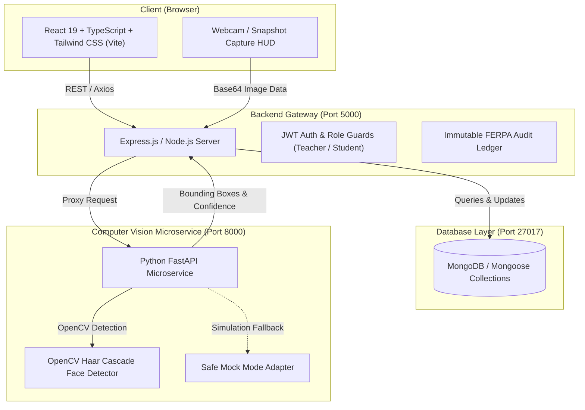

# AttendAI 🎓✨
> **AI-Powered Classroom Attendance & Engagement Analytics Platform**

[](https://github.com/mohini-yadav10/AttendAI/actions/workflows/ci.yml)
[](https://nodejs.org/)
[](https://react.dev/)
[](https://fastapi.tiangolo.com/)
[](LICENSE)

AttendAI is a modern, full-stack academic platform engineered to automate classroom roll call in seconds using computer vision while maintaining human-in-the-loop teacher verification, granular student analytics, and strict biometric privacy compliance.

---

## 🏛️ System Architecture



---

## 🚀 Key Features

- **⚡ Fast Computer Vision Attendance**: Detect and localize 50+ students in a single classroom snapshot or real-time webcam feed.
- **👨‍🏫 Human-in-the-Loop Review**: Instructors review, adjust (present / late / absent / excused), and sign off before final database commitment.
- **🛡️ Biometric Privacy & Ethics Safe Mode**: Real face localization (bounding boxes) is decoupled from biometric 1:1 identity recognition. A mock mode is active by default to protect student privacy and comply with FERPA/GDPR until explicit consent policies are configured.
- **📊 Interactive Analytics Dashboard**: Track weekly presence trends, day-of-week engagement, course comparisons, and automated early warning flags for at-risk students (< 75% attendance).
- **📋 CSV Student Import & Export**: One-click batch enrollment via CSV and exportable attendance reports formatted for institutional registrars.
- **🔐 Immutable Audit Trail**: Every status override, seed operation, and AI detection call is cryptographically logged with instructor signature and timestamp.
- **📱 Student Self-Service Portal**: Transparent student view to monitor course compliance rates, attendance history, and honors standing.

---

## 🔑 Demo Accounts & Credentials

To explore the application without manual setup:

| Role | Email | Password | Permissions |
| :--- | :--- | :--- | :--- |
| **Instructor / Teacher** | `teacher@attendai.edu` | `Password123!` | Class management, webcam capture, review, analytics, audit logs |
| **Student** | `student@attendai.edu` | `Password123!` | Personal attendance dashboard, course progress view |

*Both accounts can also be logged into with a single click using the "Instant Demo" buttons on the landing and login pages.*

---

## 📁 Repository Structure

```
attendAI/
├── backend/                  # Node.js / Express / TypeScript REST API
│   ├── src/
│   │   ├── config/           # Environment & database connections
│   │   ├── controllers/      # Controllers (Auth, Classes, Attendance, AI proxy, Analytics, Audit)
│   │   ├── middleware/       # JWT auth, role validation, rate limiting, error handling
│   │   ├── models/           # Mongoose schemas (User, StudentProfile, Class, Session, etc.)
│   │   ├── routes/           # Express API route modules
│   │   ├── scripts/          # Database seeding scripts
│   │   └── tests/            # Integration & unit test suites
│   ├── package.json
│   └── tsconfig.json
├── frontend/                 # React 19 + TypeScript + Vite + Tailwind CSS
│   ├── src/
│   │   ├── components/       # UI components (Navbar, Sidebar, StatCards, Badges, Modals)
│   │   ├── context/          # AuthContext and state management
│   │   ├── pages/            # Teacher Dashboard, Capture HUD, Review Grid, Analytics, Student Portal
│   │   ├── routes/           # AppRoutes and ProtectedRoute guards
│   │   └── services/         # Typed Axios API client wrappers
│   ├── index.html
│   └── vite.config.ts
├── ai-service/               # Python / FastAPI Computer Vision Microservice
│   ├── app/
│   │   ├── routes/           # Detection & stub endpoints (/detect-faces, /match-faces)
│   │   ├── schemas/          # Pydantic validation schemas
│   │   ├── services/         # OpenCV detector & mock adapter
│   │   └── main.py           # FastAPI application root
│   ├── tests/                # Pytest async test suite
│   └── requirements.txt
├── docs/                     # Architecture specifications & workflows
└── .github/workflows/        # GitHub Actions CI pipeline
```

---

## 🛠️ Quickstart & Local Installation

### Prerequisites
- **Node.js**: v18+ (v20+ recommended)
- **Python**: v3.11+
- **MongoDB**: Local instance running on `localhost:27017` or MongoDB Atlas URI

### 1. Clone & Configure Environment
```bash
git clone https://github.com/mohini-yadav10/AttendAI.git
cd AttendAI

# Copy environment template
cp .env.example .env
```

### 2. Setup the Frontend
```bash
cd frontend
npm install
npm run dev
# Running at http://localhost:5173
```

### 3. Setup the Backend API
```bash
cd ../backend
npm install
npm run seed     # Populate database with synthetic demo data
npm run dev
# Running at http://localhost:5000
```

### 4. Setup the Python AI Vision Service
```bash
cd ../ai-service
python -m venv .venv
source .venv/bin/activate  # On Windows: .venv\Scripts\activate
pip install -r requirements.txt
uvicorn app.main:app --reload --port 8000
# Running at http://localhost:8000
```

---

## 📡 Core API Reference

| Method | Endpoint | Access | Description |
| :--- | :--- | :--- | :--- |
| `POST` | `/api/auth/login` | Public | Authenticate user & return JWT token |
| `POST` | `/api/auth/register` | Public | Register new instructor or student |
| `GET` | `/api/classes` | Teacher | List all classes for instructor |
| `POST` | `/api/classes` | Teacher | Create a new class |
| `GET` | `/api/students` | Teacher | List roster & filter by department |
| `POST` | `/api/students/import`| Teacher | Bulk import students via CSV |
| `GET` | `/api/sessions` | Teacher | Retrieve sessions & attendance stats |
| `POST` | `/api/ai/detect-faces`| Teacher | Forward image to AI service & return bounding boxes |
| `POST` | `/api/sessions/:id/attendance/review` | Teacher | Commit finalized attendance records |
| `GET` | `/api/analytics/overview` | Teacher | Retrieve attendance KPIs and trends |
| `GET` | `/api/audit` | Teacher | Query immutable audit logs |
| `GET` | `/api/health` | Public | System and microservice health check |

---

## 🧪 Running Automated Tests

```bash
# Frontend Build Verification
cd frontend && npm run build

# AI Service Pytest Suite
cd ai-service && pytest
```

---

## 📜 Ethical AI & Privacy Statement

AttendAI is intentionally designed with student privacy as a first-class architectural concern:
1. **Facial Detection vs. Identification**: The vision microservice localizes faces within a frame without storing persistent biometric templates unless an explicit institution opt-in and consent policy is active.
2. **Mock Mode Fallback**: In development, testing, and continuous integration environments, `AI_MOCK_MODE=true` simulates high-fidelity bounding box coordinates without needing webcam hardware or real photos.
3. **FERPA Audit Compliance**: Any attendance change made by a human instructor or automated process is permanently recorded in an append-only audit log.

---

## 📄 License

This project is licensed under the [MIT License](LICENSE).
