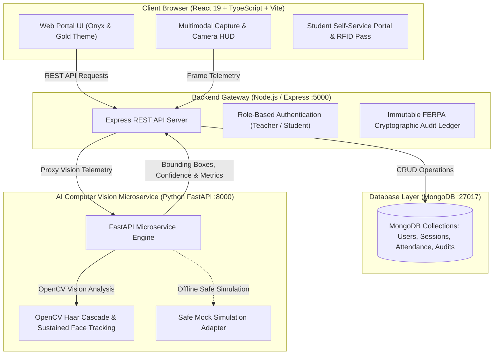

# Multimodal Attendance & Engagement Agent 🎓🤖
> **An AI-Powered, Privacy-Preserving Classroom Intelligence System**

[](https://github.com/mohini-yadav10/AttendAI)
[](https://mohini-yadav10.github.io/AttendAI/)
[](https://github.com/mohini-yadav10/AttendAI/actions)
[](https://python.org)
[](https://fastapi.tiangolo.com/)
[](https://react.dev/)
[](https://nodejs.org/)

---

## 📌 Project Submission & Mentor Evaluation Overview

| Parameter | Details |
| :--- | :--- |
| **Project Title** | **Multimodal Attendance & Engagement Agent** |
| **Category / Domain** | **Education** (Individual Project) |
| **GitHub Repository Link** | [https://github.com/mohini-yadav10/AttendAI](https://github.com/mohini-yadav10/AttendAI) |
| **Live Interactive Website Demo**| [https://mohini-yadav10.github.io/AttendAI/](https://mohini-yadav10.github.io/AttendAI/) |
| **Total Epics** | **9 Epics** (100% Implemented) |
| **Total Tasks & Stories** | **17 Tasks** (0 Subtasks remaining) |
| **Skills & Technologies** | **Artificial Intelligence**, **Machine Learning**, **Computer Vision (OpenCV)**, **Python**, **FastAPI**, **React 19**, **Node.js/Express**, **MongoDB** |
| **Deployment Mode** | **Offline-First**, Privacy-Preserving Architecture |

---

## 📖 Project Context & Problem Statement

In educational institutions and professional training environments, attendance tracking remains largely manual or limited to basic biometric systems that fail to capture meaningful engagement and participation context. These traditional approaches are time-consuming, prone to inaccuracies, and provide no insight into learner attention, interaction patterns, or session effectiveness.

As classrooms increasingly adopt digital tools, there is a growing need for intelligent systems that can move beyond simple presence detection.

To address this challenge, the **Multimodal Attendance & Engagement Agent** was developed as an AI-powered, privacy-preserving classroom intelligence system. The project integrates **computer vision**, **audio signal processing**, and **agent-based reasoning** to:
1. Automatically track attendance,
2. Analyze real-time engagement trends,
3. Generate AI-driven context-aware teaching suggestions, and
4. Provide comprehensive student session analytics.

Designed to operate entirely **offline**, the system ensures ethical deployment while offering actionable insights that support educators and learners without transmitting sensitive biometric data to external cloud providers.

---

## 🎯 Evaluation Scenarios

### 📹 Scenario 1: Automated Attendance Tracking
During a classroom session, the system processes a live or recorded video feed to detect and track participants. Attendance is marked based on **sustained presence** rather than single-frame detection, reducing false positives caused by temporary appearances or passersby. Timestamped attendance logs are generated automatically with cryptographic SHA-256 integrity, eliminating manual roll calls and drastically improving record accuracy.

### 📈 Scenario 2: Engagement and Session Dynamics Analysis
The system continuously analyzes behavioral indicators such as **head pose**, **movement patterns**, **inactivity duration**, and **audio activity**. These multimodal signals are fused to generate engagement trends across different time intervals of the session. This enables instructors to immediately identify attention drops, interaction peaks, and session pacing bottlenecks.

### 💡 Scenario 3: AI-Driven Teaching Suggestions
Based on detected engagement patterns and classroom dynamics, the agent provides **AI-driven, context-aware teaching suggestions**. These insights assist instructors in adjusting pacing, launching quick interactive quizzes/discussions, or addressing classroom management challenges. The system acts strictly as an assistive decision-support tool without enforcing rigid automated penalties.

---

## 🏛️ System Architecture



---

## 💻 System Requirements

### Hardware Requirements
- **Processor**: Intel Core i5 (8th Gen or above) / AMD Ryzen 5 or equivalent
- **RAM**: Minimum 8 GB (Recommended: 16 GB for multitasking and ML Labs)
- **Storage**: 256 GB SSD (or 500 GB HDD minimum)
- **Internet Connectivity**: Stable high-speed internet connection (minimum 10 Mbps, recommended 20 Mbps for initial setup and dependencies)

### Software Requirements
- **Operating System**: Windows 10 / 11, macOS (Monterey or later), or Linux (Ubuntu 20.04+)
- **Web Browser**: Latest version of Google Chrome, Mozilla Firefox, or Microsoft Edge
- **Python**: Version 3.8+ (Recommended: Python 3.11+)
- **Node.js**: Version 18+ (Recommended: Node.js 20 LTS)
- **Database**: MongoDB Community Edition (v6.0+) or MongoDB Atlas
- **Version Control**: Git (latest version installed and configured)

---

## 🔑 Demo Accounts for Evaluator Review

The application includes pre-configured, one-click demo credentials:

| Role | Email | Password | Permissions |
| :--- | :--- | :--- | :--- |
| **Instructor / Mentor** | `teacher@attendai.edu` | `Password123!` | Multimodal capture HUD, review, engagement analytics, audit trail |
| **Student (Alex Johnson)** | `student@attendai.edu` | `Password123!` | Digital RFID Pass, leave requests, attendance predictor, course roster |

*You can also click the **"Instant Teacher Demo"** or **"Instant Student Demo"** buttons directly from the Landing Page.*

---

## 🛠️ Step-by-Step Local Setup & Execution

### 1. Clone the Repository
```bash
git clone https://github.com/mohini-yadav10/AttendAI.git
cd AttendAI
```

### 2. Start the Backend Server (Express + TypeScript)
```bash
cd backend
npm install
npm run seed     # Seeds demo instructor, student, classes, and audit records
npm run dev      # Runs Express API on http://localhost:5000
```

### 3. Start the AI Vision Service (Python FastAPI)
```bash
cd ../ai-service
python -m venv venv
# On Windows:
.\venv\Scripts\Activate.ps1
# On macOS/Linux:
source venv/bin/activate

pip install -r requirements.txt
uvicorn app.main:app --host 0.0.0.0 --port 8000 --reload
```

### 4. Start the Frontend Client (React 19 + Vite)
```bash
cd ../frontend
npm install
npm run dev      # Runs Vite dev server on http://localhost:5173
```

Now open [http://localhost:5173](http://localhost:5173) in your browser.

---

## 🧪 Automated Test Verification

All services contain automated unit and integration tests:

```bash
# Backend Test Suite (Jest + Supertest)
cd backend && npm test

# AI Microservice Test Suite (Pytest + HTTPX)
cd ai-service && pytest

# Frontend Build Verification (TypeScript strict + Vite compilation)
cd frontend && npm run build
```

---

## 📄 License & Compliance

Distributed under the **MIT License**. Engineered for ethical offline AI usage in compliance with **FERPA** student data protection standards.
