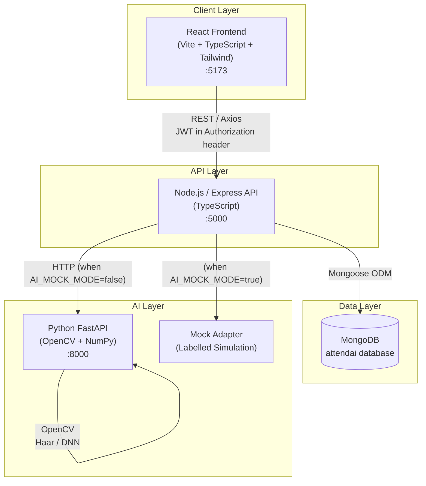
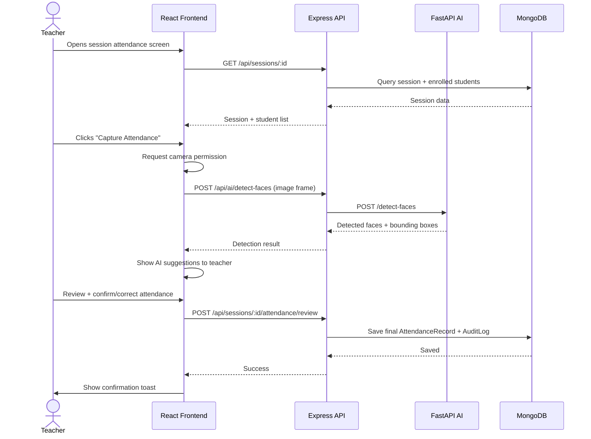
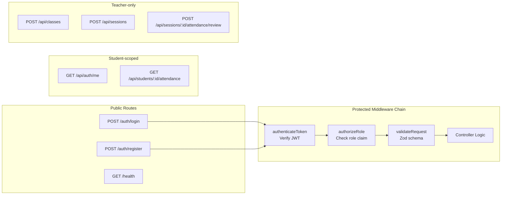

# AttendAI Architecture

## System Overview

AttendAI is a modular, full-stack educational technology platform. Each service is independently runnable and testable.

## Architecture Diagram



## Request Flow — Attendance Capture



## Data Model Relationships

```mermaid
erDiagram
    User {
        ObjectId _id
        string name
        string email
        string passwordHash
        enum role
        date createdAt
    }

    Class {
        ObjectId _id
        string name
        string code
        ObjectId teacher
        boolean archived
    }

    Course {
        ObjectId _id
        string name
        string code
        ObjectId class
    }

    StudentProfile {
        ObjectId _id
        string name
        string studentId
        string email
        ObjectId enrolledBy
    }

    Enrollment {
        ObjectId _id
        ObjectId student
        ObjectId class
        ObjectId course
        enum status
    }

    Session {
        ObjectId _id
        ObjectId class
        ObjectId course
        ObjectId teacher
        date date
        enum status
    }

    AttendanceRecord {
        ObjectId _id
        ObjectId student
        ObjectId session
        enum status
        enum entryMethod
        boolean aiReviewed
        ObjectId confirmedBy
        array correctionHistory
    }

    ParticipationEvent {
        ObjectId _id
        ObjectId student
        ObjectId session
        enum eventType
        string note
    }

    AuditLog {
        ObjectId _id
        ObjectId user
        string action
        string resourceType
        ObjectId resourceId
        object changes
    }

    User ||--o{ Class : "teaches"
    Class ||--o{ Course : "contains"
    Class ||--o{ Enrollment : "has"
    StudentProfile ||--o{ Enrollment : "enrolled_in"
    Class ||--o{ Session : "has"
    Session ||--o{ AttendanceRecord : "records"
    StudentProfile ||--o{ AttendanceRecord : "has"
    Session ||--o{ ParticipationEvent : "logs"
    User ||--o{ AuditLog : "generates"
```

## Security Architecture



## Service Ports

| Service | Port | URL |
|---------|------|-----|
| React Frontend | 5173 | http://localhost:5173 |
| Express Backend | 5000 | http://localhost:5000 |
| FastAPI AI Service | 8000 | http://localhost:8000 |
| MongoDB | 27017 | mongodb://localhost:27017 |

## Technology Decisions

| Decision | Choice | Rationale |
|----------|--------|-----------|
| Frontend framework | React + Vite | Fast DX, TypeScript support, industry standard |
| Styling | Tailwind CSS | Utility-first, consistent design tokens |
| Charts | Recharts | React-native, composable |
| Backend framework | Express | Mature, flexible, wide ecosystem |
| ORM | Mongoose | MongoDB-native, schema validation |
| Auth | JWT (HS256) | Stateless, role claims in token |
| Password hashing | bcryptjs | Battle-tested, configurable work factor |
| Input validation | Zod | TypeScript-first, shared with frontend |
| AI framework | FastAPI | Async, auto-docs, Pydantic validation |
| Face detection | OpenCV Haar/DNN | No external API cost, offline capable |
| Face matching | Mock only (v1) | Privacy/consent review required for real matching |

## Privacy & Compliance Notes

- Raw camera frames are NOT stored by default.
- AI detection results are advisory only — a teacher must confirm all records.
- Face matching against stored reference images requires explicit informed consent and is not enabled in v1.
- Synthetic demo data only — no real student PII in seed files.
- Audit logs track all attendance corrections with timestamps and responsible users.
